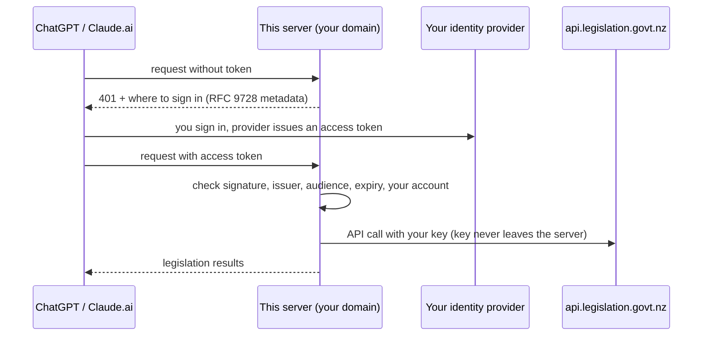

# Self-hosting a remote endpoint

Most people should run this server **locally** (stdio): Claude Desktop, Claude Code, Codex, Cursor and VS Code all support that, and nothing is exposed to the internet. See the README.

You need a **remote** endpoint only for clients that cannot start a local program: ChatGPT, Claude on the web or mobile, and Grok. This guide covers that.

> Not an official Parliamentary Counsel Office (PCO) product. Results are not legal advice; check the official version on legislation.govt.nz.

## How it works and why it is locked down

- The server holds **your** Legislation API key. The PCO API terms (clause 6) say you must not let anyone else use your key, so a remote endpoint must admit **only you**.
- Sign-in uses **OAuth 2.1** through an identity provider you control (for example Auth0 or Keycloak). This server never sees passwords: it only checks the signed access tokens your provider issues, and admits only the account(s) you list in `LEGISLATION_NZ_OAUTH_ALLOWED_SUBJECTS`.
- The server **refuses to start** in any setup that could be reached from elsewhere without OAuth: a non-loopback bind address, or a public URL (including a tunnel or reverse proxy in front of a loopback server).
- Other protections: Host and Origin checks, per-user and per-IP rate limits, request-size limits, security headers, no JSON-RPC batches, non-root read-only container.



## What you need

1. A Legislation API key (request one from contact@pco.govt.nz).
2. A domain name for the server, e.g. `mcp.example.com`, with HTTPS (the Caddy example below obtains certificates automatically).
3. Somewhere to run a container (a small VM or container host).
4. An identity provider account. See [Choosing a provider](#choosing-a-provider).

## Quick start with Docker Compose and Caddy

`deploy/docker-compose.yml` runs the server behind [Caddy](https://caddyserver.com), which terminates TLS with automatic certificates.

1. Copy `deploy/` to your server.
2. Put your API key in `deploy/secrets/legislation_api_key` (one line, file mode `600`). Docker passes it as a secret file, so it is not in environment variables or `docker inspect`.
3. Copy `deploy/.env.example` to `deploy/.env` and fill in your domain and provider values (see [Configuration](#configuration)).
4. Point your domain's DNS at the server, then run `docker compose up -d` in `deploy/`.
5. Check `https://mcp.example.com/healthz` returns `{"status":"ok"}`, and `https://mcp.example.com/.well-known/oauth-protected-resource/mcp` names your provider.

Running the container directly instead:

```sh
docker run -d --name nz-legislation-mcp \
  --read-only --cap-drop ALL --security-opt no-new-privileges \
  -p 127.0.0.1:8080:8080 \
  -v "$PWD/secrets/legislation_api_key:/run/secrets/legislation_api_key:ro" \
  -e LEGISLATION_NZ_API_KEY_FILE=/run/secrets/legislation_api_key \
  -e LEGISLATION_NZ_PUBLIC_URL=https://mcp.example.com/mcp \
  -e LEGISLATION_NZ_OAUTH_ISSUER=https://YOUR-PROVIDER/ \
  -e LEGISLATION_NZ_OAUTH_ALLOWED_SUBJECTS=YOUR-ACCOUNT-ID \
  ghcr.io/thatskiff33-agents/nz-legislation-mcp:latest
```

The image is published to GitHub Container Registry from the first release onwards (signed with Sigstore cosign, with an SBOM and build provenance). Until then, build it yourself with `docker build -t nz-legislation-mcp .`.

Put an HTTPS reverse proxy in front of port 8080. Pass the original `Host` header through unchanged (the server checks it against `LEGISLATION_NZ_PUBLIC_URL`).

## Configuration

All settings are environment variables. The server checks them at start-up and exits with a clear message if anything is wrong or unsafe.

| Variable                                | Required         | Default                                  | Meaning                                                                                                                             |
| --------------------------------------- | ---------------- | ---------------------------------------- | ----------------------------------------------------------------------------------------------------------------------------------- |
| `LEGISLATION_NZ_API_KEY`                | One of these two |                                          | Your Legislation API key.                                                                                                           |
| `LEGISLATION_NZ_API_KEY_FILE`           | One of these two |                                          | Path to a file holding the key (preferred in containers).                                                                           |
| `LEGISLATION_NZ_PUBLIC_URL`             | Remote           |                                          | Public URL of the endpoint, ending in `/mcp`, e.g. `https://mcp.example.com/mcp`. It is also the token audience.                    |
| `LEGISLATION_NZ_OAUTH_ISSUER`           | Remote           |                                          | Your provider's issuer URL, exactly as it appears in tokens (`iss`).                                                                |
| `LEGISLATION_NZ_OAUTH_ALLOWED_SUBJECTS` | Remote           |                                          | Comma-separated account IDs (`sub` claim) allowed in: you.                                                                          |
| `LEGISLATION_NZ_OAUTH_AUDIENCE`         | No               | the public URL                           | Expected token audience, if your provider cannot use the URL. Use a value unique to this server.                                    |
| `LEGISLATION_NZ_OAUTH_JWKS_URL`         | No               | discovered                               | Signing-key URL, if your provider's metadata has none. Must be https.                                                               |
| `LEGISLATION_NZ_OAUTH_REQUIRED_SCOPES`  | No               | none                                     | Scopes every token must carry, space or comma separated.                                                                            |
| `LEGISLATION_NZ_OAUTH_REQUIRE_AT_JWT`   | No               | `false`                                  | `true` to require the RFC 9068 `at+jwt` token type (if your provider sets it).                                                      |
| `LEGISLATION_NZ_HTTP_HOST`              | No               | `127.0.0.1` (`0.0.0.0` in the container) | Address to listen on.                                                                                                               |
| `LEGISLATION_NZ_HTTP_PORT`              | No               | `8080`                                   | Port to listen on.                                                                                                                  |
| `LEGISLATION_NZ_ALLOWED_ORIGINS`        | No               | none                                     | Browser origins (hostnames) allowed to call the endpoint directly. Not needed for ChatGPT or Claude, which call from their servers. |
| `LEGISLATION_NZ_RATE_LIMIT_PER_MINUTE`  | No               | `60`                                     | Requests per minute per user (the per-IP limit for unauthenticated traffic is five times this).                                     |
| `LEGISLATION_NZ_TIMEOUT_MS`             | No               | `15000`                                  | Timeout for each Legislation API request.                                                                                           |
| `LEGISLATION_NZ_CACHE`                  | No               | `off`                                    | `memory` to cache API responses and rendered text in memory. Off until the PCO confirms caching is allowed.                         |
| `LEGISLATION_NZ_LOG_LEVEL`              | No               | `info`                                   | `debug`, `info`, `warn` or `error`. Logs go to stderr as JSON lines, with your key redacted.                                        |

## Choosing a provider

Your provider must issue **JWT access tokens** whose audience is this server, and must let ChatGPT or Claude register as a client. Client support differs:

| Provider | ChatGPT                              | Claude (web, Desktop, Code) | Notes                                                                                     |
| -------- | ------------------------------------ | --------------------------- | ----------------------------------------------------------------------------------------- |
| Auth0    | Yes, via dynamic client registration | Yes                         | Hosted; free tier available. Recipe below (not yet end-to-end tested by the maintainers). |
| Keycloak | No (per Keycloak's own guide)        | Yes                         | Self-hosted, open source. Recipe below (token validation tested).                         |

Other providers can work if they meet the requirements above; the server is a standard OAuth 2.1 resource server.

### Recipe: Keycloak (Claude clients)

Tested on 2 November 2026 with Keycloak 26.4.5: a token issued for the configured user was accepted, and a valid token for a different user, a missing token and a tampered token were refused. The interactive sign-in from a Claude client was not tested by the maintainers; follow Keycloak's guide for that part.

1. In a realm (e.g. `nzlm`), create your user.
2. Create a client scope or client mapper of type **Audience** with **Included Custom Audience** set to your `LEGISLATION_NZ_PUBLIC_URL` (e.g. `https://mcp.example.com/mcp`), added to the access token. This makes the token's audience this server.
3. Set up client registration for the Claude client you use (Client ID Metadata Documents or anonymous dynamic registration) following [Keycloak's MCP guide](https://www.keycloak.org/securing-apps/mcp-authz-server), which lists the exact client-policy settings for Claude Code and Claude Desktop.
4. Configure this server:
   - `LEGISLATION_NZ_OAUTH_ISSUER=https://keycloak.example.com/realms/nzlm` (the realm URL, as in the token's `iss`).
   - `LEGISLATION_NZ_OAUTH_ALLOWED_SUBJECTS=` your user's ID (Users, select the user, copy **ID**; it is the token's `sub`).

### Recipe: Auth0 (ChatGPT and Claude)

Not yet end-to-end tested by the maintainers; based on the sources listed below. Labels in the Auth0 dashboard may differ.

1. Create an **API** whose **Identifier** is your `LEGISLATION_NZ_PUBLIC_URL` (e.g. `https://mcp.example.com/mcp`). Auth0 then issues JWT access tokens with that audience.
2. In tenant settings, enable **Dynamic Client Registration** (ChatGPT and Claude register themselves) and the **Resource Parameter Compatibility Profile** (so the MCP `resource` parameter is used as the audience).
3. Find your account's user ID (User Management, Users, your user; it looks like `auth0|...`).
4. Configure this server:
   - `LEGISLATION_NZ_OAUTH_ISSUER=https://YOUR-TENANT.auth0.com/` (with the trailing slash, as in the token's `iss`).
   - `LEGISLATION_NZ_OAUTH_ALLOWED_SUBJECTS=` your user ID.
5. Anyone can register a client with your tenant, but only the accounts you list are let in by this server.

## Connecting clients

- **ChatGPT:** add a custom MCP connector (developer mode / plugins, depending on your plan) with the URL `https://mcp.example.com/mcp`. ChatGPT discovers your provider from the server, then asks you to sign in. ChatGPT prefers Client ID Metadata Documents and otherwise uses dynamic client registration ([OpenAI documentation](https://developers.openai.com/plugins/build/auth)).
- **Claude (web, Desktop):** add a custom connector with the same URL. Claude supports dynamic client registration and Client ID Metadata Documents ([Anthropic documentation](https://claude.com/docs/connectors/building/authentication)).
- **Grok:** the xAI API can call remote MCP servers and lets you pass an `authorization` value ([xAI documentation](https://docs.x.ai/developers/tools/remote-mcp)). Because this server only accepts short-lived OAuth access tokens, you would need to obtain a fresh token from your provider and pass `Bearer <token>`; there is no long-lived key option, by design.

## Troubleshooting

| Symptom                                               | Likely cause                                                                                                                           |
| ----------------------------------------------------- | -------------------------------------------------------------------------------------------------------------------------------------- |
| Server exits at start-up with "Invalid configuration" | Read the listed problems; each names the variable to fix.                                                                              |
| `401` with `invalid_token`                            | Wrong issuer or audience, expired token, or a token from a different provider. Compare the token's `iss` and `aud` with your settings. |
| `403` with `forbidden`                                | The token is valid but its `sub` is not in `LEGISLATION_NZ_OAUTH_ALLOWED_SUBJECTS`.                                                    |
| `403` "Invalid Host header"                           | Your reverse proxy changed the `Host` header; pass it through unchanged.                                                               |
| `429`                                                 | Rate limit reached; wait a minute or raise `LEGISLATION_NZ_RATE_LIMIT_PER_MINUTE`.                                                     |
| Tool results say the daily quota is used up           | Your key's 10,000 requests for the day are spent; it resets at midnight NZ time.                                                       |

## Local HTTP mode (no sign-in)

`nz-legislation-mcp http` with no OAuth settings listens on `127.0.0.1` only and answers only `localhost` host names. It is for a **single user on their own computer** (for example a client that prefers HTTP to stdio). Anyone else with access to that computer could use it, and it must never be exposed through a tunnel or proxy (the server refuses to start if you set a public URL without OAuth).

## Sources

- MCP authorization specification (2026-07-28): https://modelcontextprotocol.io/specification/2026-07-28/basic/authorization
- PCO API terms of use: https://www.legislation.govt.nz/learn-more/legislation-data/api-terms-of-use/
- Keycloak as an MCP authorization server: https://www.keycloak.org/securing-apps/mcp-authz-server
- OpenAI, authentication for MCP plugins and connectors: https://developers.openai.com/plugins/build/auth
- Anthropic, authentication for connectors: https://claude.com/docs/connectors/building/authentication
- xAI, remote MCP tools: https://docs.x.ai/developers/tools/remote-mcp
- Auth0 recipe basis: Auth0 support article on the MCP audience error (https://support.auth0.com/center/s/article/mcp-audience-error-with-auth0) and Apollo's Auth0 guide (https://www.apollographql.com/docs/apollo-mcp-server/guides/auth-auth0)
