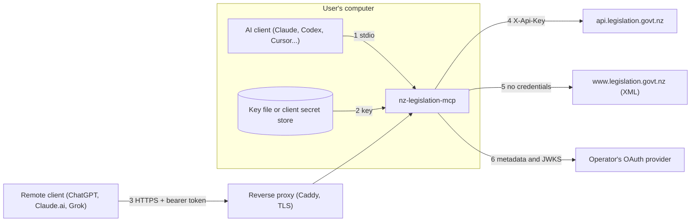

# Threat model

What this server protects, who might attack it, and how each risk is handled. It covers the
local (stdio) server, the self-hosted HTTP endpoint, and how releases are built. It describes the
code as it is; each mitigation names where it lives so it can be checked.

Last reviewed: 7 November 2026 (issue #49, after the quality sweep and the release setup). Review it again when a trust boundary changes (a new
outbound host, a new transport, a new publishing channel).

## What is protected

| Asset                              | Why it matters                                                                                                                                                                                                                                                                             |
| ---------------------------------- | ------------------------------------------------------------------------------------------------------------------------------------------------------------------------------------------------------------------------------------------------------------------------------------------ |
| The user's Legislation API key     | PCO's terms of use link each key to a named holder and do not allow it to be shared or used by anyone else (clause 6, and clauses 4 and 5 as recorded in `docs/api-notes.md`; read 2 November 2026 and unchanged on 6 November 2026). A leaked key can be misused under the holder's name. |
| The key's daily quota              | 10,000 requests per key per day by default. Exhausting it denies the holder service until midnight NZ time.                                                                                                                                                                                |
| Accuracy of what the model is told | People may rely on the text. Wrong or stale text, or text from the wrong version, can mislead.                                                                                                                                                                                             |
| The operator's host (self-hosting) | The HTTP endpoint is reachable from the internet.                                                                                                                                                                                                                                          |
| OAuth access tokens (self-hosting) | They admit a caller to the operator's endpoint, and so to the operator's key.                                                                                                                                                                                                              |
| Release integrity                  | Users run the npm package, the Claude Desktop bundle and the container image with their key in the environment.                                                                                                                                                                            |

## Who might attack it

- A malicious or compromised MCP client, or a model steered by prompt injection, calling tools with hostile input.
- An internet attacker reaching a self-hosted endpoint, including a web page using the user's browser (DNS rebinding, cross-origin requests).
- Someone the operator did not intend to admit, holding a valid token from the same OAuth provider.
- A network attacker between the server and PCO, or a compromised upstream response.
- A compromised dependency, GitHub Action or build step.
- A local user or process on a shared machine (key file).

## Trust boundaries

Boundary 7, not drawn, is the release pipeline: source to npm, the GitHub release and GHCR.

## Threats and mitigations

### 1. Client to server (stdio, and every tool call)

| Threat                                                                           | Mitigation                                                                                                                                                                                                                                                                                                                                                                  | Where                                                                                                                                                |
| -------------------------------------------------------------------------------- | --------------------------------------------------------------------------------------------------------------------------------------------------------------------------------------------------------------------------------------------------------------------------------------------------------------------------------------------------------------------------- | ---------------------------------------------------------------------------------------------------------------------------------------------------- |
| Hostile tool input (injection into API queries, huge values, unknown parameters) | Every input is a strict Zod schema: IDs parsed against the ID grammar and vocabulary, filters limited to enums, free text length-limited with control characters and line separators refused, unknown keys rejected (search and list_versions also name the allowed parameters). Query strings are built with `URLSearchParams`.                                            | `src/domain/schemas.ts`, `src/domain/ids.ts`, `src/tools/*.ts`                                                                                       |
| Hostile resource URIs and prompt arguments                                       | Resource reads validate with the tools' own input schemas before any API call; values are percent-decoded once and a malformed encoding or surrounding spaces are rejected. Prompt arguments are length-limited, control-free and quoted.                                                                                                                                   | `src/resources.ts`, `src/prompts.ts`                                                                                                                 |
| Output too large for the model's context, or used to exhaust memory              | Provision text paged (default 15,000, maximum 50,000 characters); contents capped at 500 entries; comparisons capped at 30,000 characters, and the diff gives up rather than build a table over 4,000,000 cells; rendered document text capped at 2,000,000 characters, enforced within a line as well; the optional text cache keeps duplicate matches without their text. | `src/tools/get-provision-text.ts`, `src/tools/get-table-of-contents.ts`, `src/tools/compare-versions.ts`, `src/text/diff.ts`, `src/text/document.ts` |
| The key returned to the model or logged                                          | The key is held in a `Secret` (private field, redacted when converted to text or JSON) and the logger redacts it from every string and object key, including what `toJSON` produces; byte buffers are logged as a length. Keys with quotes or backslashes are refused, so JSON escaping cannot hide a key from the redactor. Error messages never include it.               | `src/secret.ts`, `src/logger.ts`, `src/api/errors.ts`                                                                                                |
| stdout corrupted (it carries the MCP protocol)                                   | Logs go to stderr only; `no-console` is a lint error.                                                                                                                                                                                                                                                                                                                       | `src/logger.ts`, `eslint.config.js`                                                                                                                  |
| Prompt injection inside legislation text                                         | Text comes only from PCO's own hosts (boundaries 4 and 5); control, zero-width and bidirectional-override characters are removed. Residual: the text is not otherwise marked as data, so clients must treat tool output as untrusted, as the MCP specification asks.                                                                                                        | `src/text/document.ts`                                                                                                                               |

### 2. The key at rest

| Threat                                                                                                | Mitigation                                                                                                                                                                                                                                                                                                                                                                                                                                                                                    | Where                                           |
| ----------------------------------------------------------------------------------------------------- | --------------------------------------------------------------------------------------------------------------------------------------------------------------------------------------------------------------------------------------------------------------------------------------------------------------------------------------------------------------------------------------------------------------------------------------------------------------------------------------------- | ----------------------------------------------- |
| Key file readable by other users                                                                      | `setup` creates the folder with mode 700 (and tightens an existing one) and writes the file with mode 600 through a temporary file, fsync and rename. The server refuses the default key file if group or others can read it (not checked on Windows, where the user profile's permissions apply). A file named by `LEGISLATION_NZ_API_KEY_FILE`, such as a container secret, is the operator's responsibility.                                                                               | `src/cli/setup.ts`, `src/config.ts`             |
| A planted key file (another person's key, breaching the terms) or a key file in the current directory | The default path is under the user's own config folder; empty or relative `XDG_CONFIG_HOME` or `APPDATA` values are ignored.                                                                                                                                                                                                                                                                                                                                                                  | `src/config.ts`                                 |
| Key file swapped or pointed at a device                                                               | The file is opened once, checked with `fstat` (regular file, at most 4 KB, non-blocking open so a FIFO cannot hang) and read from the same descriptor.                                                                                                                                                                                                                                                                                                                                        | `src/config.ts`                                 |
| Placeholder or unexpanded values used as a key                                                        | Placeholders and `${...}` are rejected with a clear message.                                                                                                                                                                                                                                                                                                                                                                                                                                  | `src/config.ts`                                 |
| Key shown on screen during setup                                                                      | Entry is hidden in raw mode. If the input is not a terminal that supports raw mode (for example Git Bash or mintty without winpty), setup refuses before prompting or reading; piped input needs the explicit `--key-stdin` flag, which refuses an interactive terminal. Residual: mintty without winpty presents a typing user as a pipe, so `--key-stdin` typed there is shown; the docs suggest `--key-stdin < keyfile`. Ctrl-C and terminal errors restore the terminal and save nothing. | `src/cli/terminal.ts`, `src/cli/setup.ts`       |
| Key in client config files                                                                            | Not needed: `setup` stores it once. The Claude Code plugin and Claude Desktop bundle store it in the system's secure store through their `sensitive` settings, then pass it to the server in its environment (see residual risks).                                                                                                                                                                                                                                                            | `src/cli/clients.ts`, `scripts/distribution.ts` |

### 3. Remote clients to the self-hosted endpoint

| Threat                                                              | Mitigation                                                                                                                                                                                                                                                                                                                                                                                                                                                                                                                                                                                                                                                                                                                                                                                                                                                                                                                                                                                                                                                                                                                                                                       | Where                                                              |
| ------------------------------------------------------------------- | -------------------------------------------------------------------------------------------------------------------------------------------------------------------------------------------------------------------------------------------------------------------------------------------------------------------------------------------------------------------------------------------------------------------------------------------------------------------------------------------------------------------------------------------------------------------------------------------------------------------------------------------------------------------------------------------------------------------------------------------------------------------------------------------------------------------------------------------------------------------------------------------------------------------------------------------------------------------------------------------------------------------------------------------------------------------------------------------------------------------------------------------------------------------------------- | ------------------------------------------------------------------ |
| Endpoint exposed without authentication                             | OAuth is required whenever the bind address or public URL is not loopback; the server will not start otherwise.                                                                                                                                                                                                                                                                                                                                                                                                                                                                                                                                                                                                                                                                                                                                                                                                                                                                                                                                                                                                                                                                  | `src/http/config.ts`                                               |
| Anyone with a token from the same provider using the operator's key | Tokens must also match an allow-list of subjects (required with OAuth); others get 403.                                                                                                                                                                                                                                                                                                                                                                                                                                                                                                                                                                                                                                                                                                                                                                                                                                                                                                                                                                                                                                                                                          | `src/http/config.ts`, `src/http/app.ts`                            |
| Forged, replayed or misdirected tokens                              | JWTs verified with `jose`: asymmetric algorithms only, exact issuer and audience, `exp`, `sub` and `iat` required, maximum age 24 hours, 30 seconds of clock tolerance, optional `at+jwt` type. Signing keys only from an HTTPS JWKS URL (plain HTTP only on loopback). The discovered issuer must exactly match the configured one, and the server warns when the audience differs from the public URL. The token is never passed upstream. Refusals are logged with the error class and code only (never the token), so a key-set fetch failure after key rotation can be diagnosed.                                                                                                                                                                                                                                                                                                                                                                                                                                                                                                                                                                                           | `src/http/auth.ts`, `src/http/serve.ts`                            |
| DNS rebinding and cross-origin browser requests                     | Host header validated; browser `Origin` must be in the allow-list. With OAuth only, `GET /healthz` is exempt from these checks (still rate-limited), so the container health check works on 127.0.0.1; it returns nothing but `{"status":"ok"}`. Without OAuth nothing is exempt, so a DNS-rebinding page cannot even detect the local server.                                                                                                                                                                                                                                                                                                                                                                                                                                                                                                                                                                                                                                                                                                                                                                                                                                   | `src/http/app.ts`                                                  |
| Quota exhaustion or flooding                                        | Per-subject token bucket (default 60 requests a minute), plus a per-IP bucket for public routes and failed authentication; buckets bounded at 10,000 keys. The per-IP limit is five times the per-subject limit. The client IP comes from `X-Forwarded-For` (last entry) only when `LEGISLATION_NZ_TRUST_PROXY=true`. Without OAuth, only direct connections from this computer are served: loopback Host names, a loopback peer address, and no proxy headers (`Forwarded`, `X-Forwarded-*`, `Via` and similar). Proxies and tunnels that announce themselves are refused, and a request that reaches Node's 100-header limit is refused with 431, so padding cannot push a proxy's forwarding headers (or the last `X-Forwarded-For` hop) out of view (#66); plain TCP forwarders and proxies that add no forwarding headers are not detected (see residual risks). Refused-subject (403) responses also count against the per-IP limit; OAuth discovery has its own per-IP bucket so junk from a shared client IP cannot block the owner's sign-in; IPv6 clients are grouped by /64 (IPv4-mapped addresses are keyed as given), and a port on a forwarded address is ignored. | `src/http/rate-limit.ts`, `src/http/app.ts`, `src/http/node.ts`    |
| Resource exhaustion                                                 | 4 MB body cap (streamed), batch requests rejected, method allow-list, header and request timeouts, at most 99 headers (431 at the limit), response backpressure that stops (and releases the request) if a stalled client disconnects. A request that cannot be converted returns 400 instead of crashing the process.                                                                                                                                                                                                                                                                                                                                                                                                                                                                                                                                                                                                                                                                                                                                                                                                                                                           | `src/http/app.ts`, `src/http/node.ts`                              |
| Refusals invisible to the operator, or logs revealing who connected | Each refusal reason (host, origin, subject not allowed, insufficient scope, per-IP and per-subject rate limits, oversized body, batch, non-local connection), and each token-verification error code, writes one `warn` record a minute at most, with a count of those not logged. Records carry a 12-character unsalted SHA-256 prefix of the token subject where one is known (pseudonymous: a guessable subject can be matched), never the raw subject or an IP address.                                                                                                                                                                                                                                                                                                                                                                                                                                                                                                                                                                                                                                                                                                      | `src/http/app.ts`, `src/http/log-throttle.ts`, `src/http/serve.ts` |
| Clickjacking, sniffing and caching                                  | `Content-Security-Policy: default-src 'none'; frame-ancestors 'none'`, `X-Content-Type-Options: nosniff`, `Cache-Control: no-store`, HSTS over HTTPS.                                                                                                                                                                                                                                                                                                                                                                                                                                                                                                                                                                                                                                                                                                                                                                                                                                                                                                                                                                                                                            | `src/http/app.ts`                                                  |
| Container compromise impact                                         | Distroless, non-root (uid 65532), root-owned application files, key passed as a file secret (the guide has the operator make it readable only by that user). The Compose file adds a read-only root, all capabilities dropped, no-new-privileges, memory and process limits, and an internal-only network between the app and the proxy.                                                                                                                                                                                                                                                                                                                                                                                                                                                                                                                                                                                                                                                                                                                                                                                                                                         | `Dockerfile`, `deploy/`                                            |

### 4 and 5. Server to PCO

| Threat                                   | Mitigation                                                                                                                                                                                                                                                                                                                                                 | Where                                                                                          |
| ---------------------------------------- | ---------------------------------------------------------------------------------------------------------------------------------------------------------------------------------------------------------------------------------------------------------------------------------------------------------------------------------------------------------- | ---------------------------------------------------------------------------------------------- |
| The key sent to the wrong host           | Requests are built only for `api.legislation.govt.nz` (allow-listed origin) and must stay under `/v0/` with no `..` segments; redirects are never followed. The key goes only in the `X-Api-Key` header, never in a URL. XML downloads go only to `www.legislation.govt.nz`, from URLs built from a validated version ID, and carry no key or credentials. | `src/api/client.ts`, `src/text/xml-source.ts`, `src/domain/vocabulary.ts`                      |
| Hostile or oversized responses           | Responses parsed with tolerant Zod schemas; bodies capped at 5 MB (API) and 64 MB (XML), counted as streamed after decompression; shared results are deep-frozen. XML parsed with `sax` in strict mode, which does not expand DTD or external entities.                                                                                                    | `src/api/client.ts`, `src/domain/schemas.ts`, `src/text/xml-source.ts`, `src/text/document.ts` |
| Slow or failing upstream                 | Per-request timeouts and an overall budget, retries (2 by default) with full-jitter backoff for network errors and 502, 503 and 504, within a 25 second budget, a circuit breaker with a half-open probe, caller cancellation honoured.                                                                                                                    | `src/api/client.ts`                                                                            |
| Quota burned by repeated identical calls | Concurrent identical requests are coalesced. Response caching is off by default until PCO confirms in writing that it is allowed (issue #3).                                                                                                                                                                                                               | `src/api/cache.ts`, `src/config.ts`                                                            |
| Inaccurate or misread law                | Versions chosen "as at" a date with the documented same-day rule; agency pilot records and provisional IDs flagged; repealed text marked; tool descriptions and prompts say results are not legal advice and point to the official version.                                                                                                                | `src/tools/versions.ts`, `src/tools/*.ts`, `src/server.ts`                                     |

### 6. Server to the OAuth provider

| Threat                                                             | Mitigation                                                                                                                                                                                                                                                                                          | Where                                   |
| ------------------------------------------------------------------ | --------------------------------------------------------------------------------------------------------------------------------------------------------------------------------------------------------------------------------------------------------------------------------------------------- | --------------------------------------- |
| Metadata or key-set fetch abused (SSRF, huge responses, redirects) | Issuer and JWKS URLs come from the operator's configuration only; HTTPS required for remote keys; metadata responses capped at 64 KB with redirects refused; metadata and key-set fetches have a 10 second timeout and the key-set fetch does not follow redirects (it has no size cap of its own). | `src/http/auth.ts`, `src/http/serve.ts` |

### 7. Releases and supply chain

| Threat                                          | Mitigation                                                                                                                                                                                                                                                                                                                                                                                                                                                                                                                                                                                                                                                                                                                                                                                                                                                                                                                                                                                                                                                                                                                                                                                                                                                                                                                                                                                                                                                                                                                                                                                                                                                                                                                                                                                                                                                                                                               | Where                                                                               |
| ----------------------------------------------- | ------------------------------------------------------------------------------------------------------------------------------------------------------------------------------------------------------------------------------------------------------------------------------------------------------------------------------------------------------------------------------------------------------------------------------------------------------------------------------------------------------------------------------------------------------------------------------------------------------------------------------------------------------------------------------------------------------------------------------------------------------------------------------------------------------------------------------------------------------------------------------------------------------------------------------------------------------------------------------------------------------------------------------------------------------------------------------------------------------------------------------------------------------------------------------------------------------------------------------------------------------------------------------------------------------------------------------------------------------------------------------------------------------------------------------------------------------------------------------------------------------------------------------------------------------------------------------------------------------------------------------------------------------------------------------------------------------------------------------------------------------------------------------------------------------------------------------------------------------------------------------------------------------------------------ | ----------------------------------------------------------------------------------- |
| Compromised dependency at install               | pnpm lockfile, 14-day minimum release age, dependency build scripts blocked unless allowed, few runtime dependencies, `pnpm audit` and dependency review in CI, Dependabot with a cooldown.                                                                                                                                                                                                                                                                                                                                                                                                                                                                                                                                                                                                                                                                                                                                                                                                                                                                                                                                                                                                                                                                                                                                                                                                                                                                                                                                                                                                                                                                                                                                                                                                                                                                                                                              | `pnpm-workspace.yaml`, `.github/`                                                   |
| Compromised GitHub Action                       | Every action pinned by commit SHA; least-privilege permissions; `persist-credentials: false` except where a job must push (the release-PR pin update); release-please and the pin update write with a short-lived token for a dedicated GitHub App (their workflow token is read-only; the App key is a secret of a `release-pr` environment that only runs on `main`), and a `v*` tag ruleset lets only that App create release tags and nobody move or delete them; base images and the BuildKit builder image pinned by digest, and no emulator or unpinned Dockerfile frontend in the container build; step-security harden-runner (audit mode).                                                                                                                                                                                                                                                                                                                                                                                                                                                                                                                                                                                                                                                                                                                                                                                                                                                                                                                                                                                                                                                                                                                                                                                                                                                                     | `.github/workflows/`                                                                |
| Secrets committed                               | gitleaks in CI; test keys are a shared dummy value.                                                                                                                                                                                                                                                                                                                                                                                                                                                                                                                                                                                                                                                                                                                                                                                                                                                                                                                                                                                                                                                                                                                                                                                                                                                                                                                                                                                                                                                                                                                                                                                                                                                                                                                                                                                                                                                                      | `.github/workflows/secret-scan.yml`, `test/dummy-key.ts`                            |
| Code weaknesses                                 | TypeScript strict, ESLint strict type-checked, CodeQL, OpenSSF Scorecard, 100% test coverage gate.                                                                                                                                                                                                                                                                                                                                                                                                                                                                                                                                                                                                                                                                                                                                                                                                                                                                                                                                                                                                                                                                                                                                                                                                                                                                                                                                                                                                                                                                                                                                                                                                                                                                                                                                                                                                                       | `.github/workflows/`, `vitest.config.ts`                                            |
| Tampered release artefacts                      | The npm tarball is checked and packed in a job with no publishing rights that starts no new tool after packing; its SHA-256 reaches later jobs as a job output, which they cannot change, and every copy of the tarball is verified against it. The Claude Desktop bundle is built from the verified tarball in a separate job with the standard `zip` command, so no third-party tool runs in a release (the mcpb CLI checks the bundle in CI only); its file is verified against that job's own output, and tampering with the tarball artifact only fails the release. Publishing jobs only publish those files, after the `release` environment's 30-minute wait timer (main and `v*` only, no required reviewers; merging the release pull request is the decision to release, and a run can be cancelled during the wait), and the GitHub release stays a draft until npm, the bundle and the container are all out. The whole release workflow is off until the owner sets the `RELEASE_ENABLED` repository variable, which PUBLISHING.md says to do only after creating the environment with its branch rule and timer (GitHub would otherwise create it with neither on first use). There is no tag-push publishing route, and `npm publish` runs with `--ignore-scripts`. The container is built from the release tag in its own job behind the same timer; each architecture is built on its own native runner and scanned by Trivy before it is pushed by digest; the multi-architecture image is then tagged and signed. npm via trusted publishing with provenance (no stored token; the trusted publisher is bound to `release.yml` and the `release` environment, and the package name was claimed with a deprecated, code-free placeholder because npm only accepts a trusted publisher for an existing package); container signed with cosign (keyless) with SBOM and provenance and scanned by Trivy. | `.github/workflows/release.yml`, `.github/workflows/container.yml`, `PUBLISHING.md` |
| A newer, unreviewed version run by plugin users | The Claude Code plugin pins the exact released version.                                                                                                                                                                                                                                                                                                                                                                                                                                                                                                                                                                                                                                                                                                                                                                                                                                                                                                                                                                                                                                                                                                                                                                                                                                                                                                                                                                                                                                                                                                                                                                                                                                                                                                                                                                                                                                                                  | `scripts/distribution.ts`, `scripts/sync-release-files.mjs`                         |

## Residual risks and accepted limits

- **The key is in the server's memory and environment.** Anything that can read the process (same user, debugger) can read the key. This is inherent to a local server.
- **Client-side npx runs.** The README and client snippets run `npx -y nz-legislation-mcp` without a version, and the npm package does not ship a shrinkwrap file, so a client start can resolve newer transitive dependencies than the lockfile. The plugin and the bundle are pinned; other clients follow npm's latest release.
- **Local no-auth HTTP mode on a shared computer.** Without OAuth, `nz-legislation-mcp http` serves any direct connection from the same computer. On a machine with other users, they can use the key holder's quota through it, which PCO terms clause 6 does not allow. The start-up warning and `docs/self-hosting.md` say not to use it on a shared machine; stdio mode, or HTTP mode with OAuth, avoids it.
- **No human approval before publishing.** Owner decision, 7 November 2026: the `release` environment has no required reviewers, and an agent may merge a release pull request after green CI and an independent review (AGENTS.md). A bad change that reaches `main` can therefore be published by that merge. Limits: `main`'s required CI checks (no approving review is required), the agents' independent-review rule, release tags only from the release App, and a 30-minute window, which administrators cannot bypass, to cancel the run before any publishing job starts.
- **Windows key file permissions.** The private-mode check is skipped on Windows; privacy relies on the user profile's default permissions.
- **Prompt injection in tool output.** Legislation text is official but is passed to the model as text. Clients are expected to treat tool output as untrusted.
- **The bundle check tool.** `@anthropic-ai/mcpb` 2.1.2 is run with `npx` (pinned, install scripts disabled) only in CI's `claude desktop bundle` job, which publishes nothing, to validate the manifest and compare our zip with `mcpb pack` (issue #37). Its dependency tree has open audit findings and is resolved fresh on each run, so a malicious dependency could only affect that CI job. Releases build the bundle with `zip` and run no third-party tool. The bundle format (a zip with `manifest.json` at its root) was read from the CLI's source; the manual Claude Desktop install check in #11 confirms it end to end.
- **Audit exception.** GHSA-g3hv-75wg-m249 (minimatch, development tooling only) is excepted until upstream moves (issue #15).
- **harden-runner is in audit mode.** Outbound traffic from CI is recorded but not blocked. Moving to block mode needs an endpoint allow-list built from the audit logs.
- **PCO dependence.** The API is "version zero" and may change; schema parsing fails safely and the tests use recorded fixtures.

## Sources

- MCP specification 2026-07-28, security best practices and authorization: https://modelcontextprotocol.io/specification/2026-07-28
- RFC 9728 (OAuth 2.0 protected resource metadata): https://www.rfc-editor.org/rfc/rfc9728
- PCO API terms of use: https://www.legislation.govt.nz/learn-more/legislation-data/api-terms-of-use/
- API limits and errors: https://api.legislation.govt.nz/docs/ (probe findings: issue #3)
